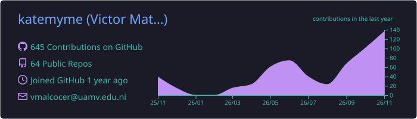
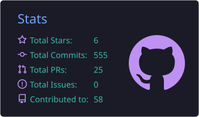
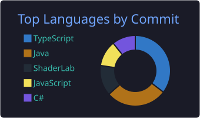
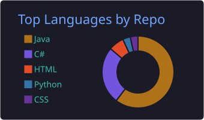

<!-- ═══════════════════════════ HEADER ═══════════════════════════ -->


<p align="center">
  
</p>

<p align="center">
  <a href="mailto:victormateoalcocerlopez@gmail.com"></a>
  <a href="https://www.linkedin.com/in/v%C3%ADctor-mateo-mi-3ba248316"></a>
  
  
</p>

---

##  `whoami`

```ts
// victor.ts
const victor = {
  ubicacion:    "Managua, Nicaragua 🇳🇮",
  universidad:  "Universidad Americana (UAM)",
  carrera:      "Ingeniería en Sistemas de la Información",
  rol:          "Backend developer — APIs REST & bases de datos",

  construyendo: [
    "Sistema Esmeralda → POS, inventario y caja multi-sucursal"
  ],

  stackFavorito: ["TypeScript", "NestJS", "PostgreSQL", "React"],
  aprendiendo:   ["Seguridad en APIs", "Optimización de consultas", "Ciberseguridad"],

  filosofia: () => "Si lo hago dos veces, lo automatizo.",
};

export default victor;
```

---

## 🛠️ Stack

<div align="center">

| | |
|:--|:--|
| **Lenguajes** |    |
| **Backend** |     |
| **Bases de datos** |    |
| **Frontend** |  |
| **Herramientas** |   |

</div>

---

##  Proyectos destacados

<table>
<tr>
<td colspan="2" valign="top">

###  [NullRadt — Salud de astronautas en misiones espaciales](https://github.com/DTCarlox77/NullRadt)
**NASA Space Apps Challenge 2026** · equipo **AndroMajes**. Monitoreo médico y psicológico *offline-first* para tripulaciones en misiones largas: la app evalúa signos vitales en el dispositivo, funciona sin señal y sincroniza con un panel en Tierra para cirujanos de vuelo y control de misión.

**Mi parte → backend y base de datos:** API REST con motor de estado y triaje, emergencias con escalamiento, enlace Tierra con retardo y cortes simulados, control de acceso por rol para datos confidenciales, migraciones SQL y simulador de datos sintéticos.

`Node.js` `Express` `PostgreSQL` `JWT` `OpenAPI / Swagger` `Docker` `React Native (Expo)` `React`

<a href="https://astro-health-api-81jd.onrender.com/api/docs"></a>


</td>
</tr>
<tr>
<td width="50%" valign="top">

###  [Sistema Esmeralda](https://github.com/katemyme/Esmeralda)
Sistema de **inventario, punto de venta y caja** para un negocio real con dos sucursales y bodega central: sesiones por equipo, devoluciones, reportes, tareas programadas y etiquetas con QR.

`NestJS` `TypeScript` `Kysely` `PostgreSQL 16` `React` `PWA` `Playwright`

</td>
<td width="50%" valign="top">

###  [Humania](https://github.com/katemyme/Humania)
Videojuego educativo sobre **derechos y dignidad de la mujer** para secundaria, con un **panel web para docentes** que gestiona salas y estudiantes.

`Unity` `React` `Vite` `Supabase` `Edge Functions`

</td>
</tr>
<tr>
<td width="50%" valign="top">

###  [Calculadora de Álgebra Lineal](https://github.com/katemyme/Calculadora-Algebra-Lineal)
Resuelve **Ax = b** con Gauss-Jordan en aritmética exacta, muestra RREF, pivotes y solución paramétrica; incluye módulo de **métodos numéricos** (bisección, graficador, errores de punto flotante).

`Python` `FastAPI` `NumPy` `SymPy` `React` `Tailwind` `pytest`

</td>
<td width="50%" valign="top">

###  [Learning Management System](https://github.com/katemyme/Learning-Management-System)
Plataforma de gestión de aprendizaje con **base de datos relacional** (constraints, vistas y triggers) y **API REST** por capas.

`SQL Server` `Node.js` `Express` `Sequelize` `React` `Tailwind`

</td>
</tr>
</table>

<details>
<summary><b>☕ Más proyectos en Java</b></summary>
<br>

| Proyecto | Qué es | Stack |
|---|---|---|
| [ProyectoHibernateG3](https://github.com/katemyme/ProyectoHibernateG3) | Persistencia con ORM | Java · Hibernate · Maven |
| [EjemploConcurrenciaG3](https://github.com/katemyme/EjemploConcurrenciaG3) | Manejo de concurrencia | Java |
| [RepoPracticaSQLJavaFX](https://github.com/katemyme/RepoPracticaSQLJavaFX) | CRUD de escritorio con base de datos | JavaFX · SQL |
| [Sistema_Bancario](https://github.com/katemyme/Sistema_Bancario) | Modelado POO de un banco | Java |

</details>

---

##  En el radar

- Formándome en **ciberseguridad**: seguridad en APIs, autenticación y buenas prácticas.
-  Diseño de índices y optimización de consultas en PostgreSQL y SQL Server.

---

##  Actividad

<div align="center">








</div>

<p align="center">
  <picture>
    <source media="(prefers-color-scheme: dark)" srcset="https://raw.githubusercontent.com/katemyme/katemyme/output/github-snake-dark.svg" />
    <source media="(prefers-color-scheme: light)" srcset="https://raw.githubusercontent.com/katemyme/katemyme/output/github-snake.svg" />
    
  </picture>
</p>

<!-- ═══════════════════════════ FOOTER ═══════════════════════════ -->

